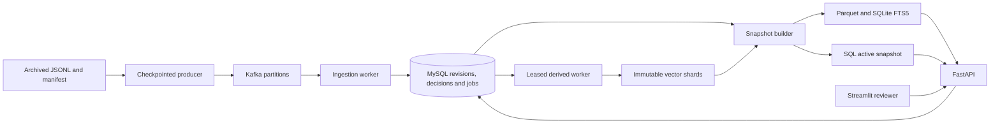

# How an update reaches a reviewer

PaperSearch runs on one Windows laptop. MySQL owns the revision and screening history. Kafka carries deliveries. A search reads a published snapshot so it can return the exact revision the reviewer saw even while a new revision arrives.

## Follow one paper through the code

1. **Deliver.** The producer archives the input before sending it, uses a stable paper key to select a Kafka partition and saves acknowledged progress. A worker can receive the same event again if it stops between a SQL commit and an offset commit. [Archive and replay](../src/papersearch/archive.py) · [Publisher and consumer](../src/papersearch/ingestion.py)
2. **Choose the current revision.** Under a database transaction, the worker records the event and recomputes its effect on the current revision. Newer source priority wins. Tied, conflicting revisions can expose an earlier unambiguous winner. A replay finds its existing marker. Malformed deliveries have a durable rejection, while a database outage leaves the offset available for retry. [Contract](record-contract.md) · [Transactional writer](../src/papersearch/storage/metadata.py) · [Crash evidence](evidence/phase3-kafka.txt)
3. **Derive.** A change of eligible text creates a durable job. Workers claim batches under expiring SQL leases. A cache hit requires matching text, model, revision and preprocessing. Publication joins against the current text, so a late worker cannot attach an older vector to a revised abstract. [Job ownership](../src/papersearch/storage/jobs.py) · [Derivation](../src/papersearch/derivation.py)
4. **Publish.** The builder exports a consistent view, verifies file hashes and row-to-paper mappings, and switches the active pointer only after validation. An interrupted build leaves the preceding snapshot readable. A zero Kafka backlog can coexist with a stale index or pending embedding jobs. [Builder](../src/papersearch/snapshots.py) · [Validator](../src/papersearch/snapshot_format.py) · [Recovery experiment](evidence/phase4-snapshots.txt)
5. **Review.** A search hit carries a snapshot and event ID. A save appends the reviewed revision, note and request UUID to project history and updates its current decision in one transaction. Retrying the same request returns the same save. Later text changes flag the paper for reconsideration. [API](../src/papersearch/api.py) · [Decision transaction](../src/papersearch/storage/reviews.py) · [Interactive workflow](../src/papersearch/reviewer.py)

## Limits of the evidence

The recovery tests interrupt processes and restart local services with their disks intact. Permanent disk loss can destroy both the broker log and the database. Rebuilding a search index requires revision data, and recovering private screening notes requires the review history. The service binds the reviewer to loopback and assumes a trusted local operator.

The capacity database and the searchable reviewer are separate installations. The reviewer uses exact cosine over its published subset and truncates input at 128 tokens. The evaluation measures historical final inclusions on two held-out drug reviews. Ranking quality on other topics and full-corpus semantic throughput remain open. [Measured coverage and resource costs](results.md) · [Held-out results](evidence/phase6-ranking.md)
