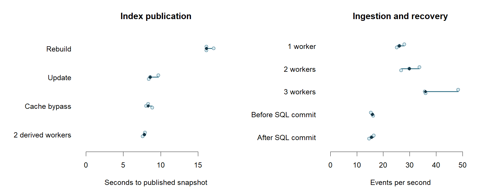

# PaperSearch system experiments

**M8, S4 and S5 passed.** On one laptop, PaperSearch accounted for all 3,050,852 lines in Cornell arXiv snapshot v287 and verified 3,050,173 current papers against an independent reference. The published reviewer still serves 100,000 lexical records and 4,878 semantic vectors. [Capacity readback](evidence/phase8-capacity.json) · [Reviewer manifest](evidence/phase6-snapshot.json)

The [clean-start verification](evidence/phase9-clean-run.md) exercises the smaller redistributable fixture from empty volumes. It also records a fresh readback of the published 100k package and checks the retained capacity evidence. Full-corpus semantic encoding (S6) remains deferred.

### Input provenance

The 100k reviewer uses a source-order prefix of Cornell arXiv v287 retrieved November 21, 2026 UTC. The full ZIP finished downloading November 22 UTC. Cornell's data card assigns CC0 to metadata and identifies individual paper licenses separately. The subset manifest and capacity evidence retain the input byte counts and hashes. [Selection and license](reviewer.md) · [Subset manifest](evidence/phase5-subset.json) · [Full ZIP identity](evidence/phase8-capacity.json)

The ranking evaluation uses three complete Cohen 2006 review tables retrieved November 21, 2026 UTC. The pinned ASReview index lists each of Antihistamines, NSAIDS and Triptans under a “custom open license” and points to the original OHSU terms, which request citation of Cohen and colleagues. The repository retains pool hashes and scores. Fetch the source tables separately to reproduce the evaluation. The BGE model is MIT-licensed and pinned by revision and file hashes. [Pinned dataset index](https://raw.githubusercontent.com/asreview/synergy-dataset/38b35218e4d0f99621cec5a8a25a0147bb88c654/index.json) · [OHSU attribution and codebook](https://dmice.ohsu.edu/cohenaa/systematic-drug-class-review-data.html) · [Exact pool identities](evidence/phase6-evaluation.json) · [Model provenance](semantic-ranking.md)

## Rebuild, update and cache reuse

All 12 publication trials produced the same 56 winners, lexical rows and ordered semantic vectors. Each full rebuild read 70 deliveries and inserted 68 revisions. Each update read 22 deliveries and added 20 revisions to the same 48-paper base. Two replays added zero revisions. All four configurations published 298,532 bytes. [Raw trials, workload digests and source fingerprints](evidence/phase8-system.json)

| Configuration | Seconds to publication, three trials | Median | Model calls / cache hits | New shard bytes |
|---|---|---:|---:|---:|
| Clean rebuild | 16.13, 17.10, 16.13 | 16.13 | 56 / 0 | 86,240 |
| Incremental, one derived worker | 8.43, 8.60, 9.70 | 8.60 | 12 / 4 | 18,480 |
| Same update, cache lookup bypassed | 8.87, 8.06, 8.33 | 8.33 | 16 / 0 | 18,480 |
| Same update, two derived workers | 7.61, 7.81, 7.92 | 7.81 | 12 / 4 | 18,480 |

The update skipped work for 40 unchanged final texts and found four previously encoded passages among its 16 jobs. Bypassing the cache made four extra model calls. The shard writer recognized those four byte-identical outputs, so both updates added the same disk bytes. The cache saved model calls, but bypassing it finished sooner end to end in two trials. With two derived workers the derivation stage took a median 1.12 s versus 1.98 s with one. [Individual timings](evidence/phase8-timings.csv)



The open circles show the three observations for each configuration. The diamond marks the median.

## Ingestion and crash recovery

All 15 stream trials reached zero lag, 384 distinct processed events and the same current-state digest. Each healthy worker received at least one partition and committed data. The rate includes publishing and draining the fixed 384-record burst. The latency column gives the median, across trials, of the per-event median from Kafka record timestamp to offset acknowledgement. Sampled client memory also includes any runtime allocations retained from preceding configurations in the same trial. [Offsets, resource samples and worker assignments](evidence/phase8-system.json)

| Healthy workers | Events/s in trial order | Median events/s | Median latency | Peak sampled lag range | Client CPU seconds range | Peak client MiB range |
|---|---|---:|---:|---:|---:|---:|
| 1 | 25.15, 26.13, 28.00 | 26.13 | 7.13 s | 365–366 | 2.82–3.05 | 202–265 |
| 2 | 26.84, 29.91, 33.72 | 29.91 | 4.92 s | 353–367 | 3.09–3.60 | 260–325 |
| 3 | 36.03, 35.70, 48.42 | 36.03 | 4.80 s | 349–362 | 3.30–3.52 | 246–385 |

One uninterrupted worker took a median 14.70 s. A crash before SQL commit increased the median to 24.09 s. From observed exit to catch-up the three runs took 21.72, 22.01 and 23.32 s. All 384 records applied once. A crash after SQL commit increased median end-to-end time to 24.67 s, with catch-up times of 24.49, 23.45 and 21.62 s. The restarted consumer received the committed SQL event again in all three cases. Its processed-event marker prevented a second metadata change. The real-service fixture separately compares the saved screening decision and history after redelivery. [Crash observations](evidence/phase8-system.json) · [Decision and replay checks](evidence/phase3-kafka.txt)

## What each run measures

The reviewer and the expansion database serve different purposes. The reviewer has a published 100,000-paper lexical index and 4,878 current embeddings. The expansion imports Cornell arXiv metadata through Kafka into a separate MySQL database. A broker acknowledgement means Kafka accepted a message. Durable ingestion ends when MySQL records the outcome and the consumer commits the offset. A paper becomes searchable when a complete index is published. [Reviewer measurements](evidence/phase5-measurements.json) · [Semantic publication](evidence/phase6-snapshot.json)

### Workloads and timing

The controlled tests use the beginning of Cornell snapshot v287 in source order. The stream uses 384 original records. The publication experiment uses the first 56 papers eligible under the existing semantic selection rule. Its 48-paper base receives 22 deliveries comprising eight abstract edits, four author edits, eight additions and two replays. Four additions reuse earlier title/abstract pairs. These changes are synthetic. The source, workload, model and oracle hashes identify the inputs exactly. The trials rotate the order of the nine configurations across three runs.

Each trial uses an empty schema, Kafka topic, consumer group and artifact store. The incremental, cache-bypass and two-worker trials prepare the same base before starting the timer. The rebuild starts with empty tables and reads both base and delta. The timer starts immediately before archive/publication and stops when the validated snapshot becomes active. It includes producer connection setup and consumer group assignment, SQL writes, derived jobs and publication. The model is already loaded. The two-worker case uses two leased job consumers sharing one CPU inference session. Batch size one exposes each actual model call. The bypass case skips cache lookup while retaining the same content-addressed shard writer.

The host was a Windows 11 i7-12700H laptop with 31.73 GiB usable RAM and one NVMe SSD. Docker Desktop 29.9.3 ran under WSL 2 with 20 logical CPUs and 16,626,061,312 bytes available to the VM. The lab embedding container had a 3 GiB ceiling and two CPUs. Services and the OS page cache stayed warm between trials. The capacity importer paused at a block boundary during the controlled trials. The independent Kafka and snapshot recovery suites overlapped portions of the first two trials. The final ranking repeats began after the controlled lab finished. The recorded base was `8c60c9dd37adef12284436629946d736162a50c4` with uncommitted changes. The evidence includes the source/configuration hashes actually measured. [Host and trial provenance](evidence/phase8-system.json)

For worker scaling, one to three separate processes join the same group with three partitions before the timer starts. The interval runs from archive/publication start to the last durable offset acknowledgement. Each worker writes the partition, offset, outcome and commit time. Lag sampling uses Kafka high-water marks and committed offsets. Client memory and CPU samples cover the experiment container and child consumers. The recovery trials terminate the consumer at partition 0, offset 16, immediately before or after SQL commit. Catch-up time starts when the driver observes process exit and ends at the final offset acknowledgement. The companion recovery suite checks screening history, raw rejections, derived jobs and metadata across failure and replay.

The capacity producer verifies the raw block digest and waits for broker acknowledgements before advancing its publication checkpoint. The consumer processes bounded groups of first-seen papers in one MySQL transaction. A collision rolls back the group and dispatches the records through normal revision resolution. Malformed inputs follow the ordinary rejection path. A separate SQLite traversal computes the expected digest in paper-ID order over current paper IDs, winning event IDs and embedding-text hashes. Comparing this digest checks the identity of every winner. An independent group offset check accounts for broker backlog. No index is published in the expansion store.

The first process exited after durable block 1. The importer restarted again at block 75 to handle malformed records without slowing adjacent valid records. Block 199 exposed a real source compatibility problem in client-side SQL parsing. Ordinary paper text included the word “delimiter”. The revised writer uses the driver's binary prepared cursor for both single and batch revision inserts. The database had already committed 768 deliveries from the block. After the fix the remaining 3,328 brought it to 4,092 accepted revisions and four rejects. A direct read of the entire stored canonical JSON for arXiv 1701.06478 matched normalized source line 879, including event ID `bf87e007e1014e44d82b8beb377f9436b489e625cf0a691311c1f79a72609f29`. Wall time includes these interruptions. Block timings cover successful checkpoint intervals, and the recovered block's acknowledgement time records the resumed confirmation.

## Metadata capacity

| Gate | Source lines | Distinct valid events | Replays | Invalid | Verified current papers | Wall time to verified gate |
|---|---:|---:|---:|---:|---:|---:|
| S4 | 1,000,482 | 1,000,000 | 0 | 482 | 1,000,000 | 71.77 min |
| S5, complete v287 | 3,050,852 | 3,050,188 | 11 | 653 | 3,050,173 | 201.05 min |

At S5, fifteen papers had two distinct revisions. The ordered SQL readback matched the reference digest `ad70ebf826ea2ebd0521e4c7f5d8e7b90b57527ace74ddb8e6606a4dc9c32d59`. The three committed offsets were 1,018,403, 1,016,476 and 1,015,973, each equal to its partition end. The original screening decision retained its reviewed revision and single history row. The expansion database had zero pending derived jobs and zero published indexes. The full readback and checks took 13.50 minutes after the final block became durable. [Per-block source checksums, timestamps and outcomes](evidence/phase8-blocks.csv) · [Reference, SQL counters, decision and offsets](evidence/phase8-capacity.json)

Across the full run, successful block intervals totaled 152.06 minutes. The wall-clock rate including repairs, pauses and verification was 252.91 source lines/s. Full-run peaks were 247.63 MiB for the importer container, 4.00 GiB for MySQL, 1.00 GiB for Kafka and 5.05 GiB for sampled VM used memory. Windows retained at least 6.32 GiB of available RAM. Minimum free disk was 223.42 GiB on the artifact drive and 210.50 GiB on the Docker host drive. MySQL reported 13.81 GiB of table and index allocation. Read-only measurement after stopping the services found 22.12 GiB in the MySQL volume and 0.405 GiB in the Kafka volume, increases of 21.04 GiB and 0.188 GiB from the first volume sample at block 33. The two volumes remain available for inspection. [Resource observations and final volume measurements](evidence/phase8-capacity.json)

The initial 33 blocks used a 128 MiB InnoDB buffer pool and 100 MiB redo capacity. MySQL attributed 122.82 seconds to revision inserts by that point. With 9.37 GiB of Windows RAM available, the isolated service moved to a 2 GiB buffer pool, 1 GiB redo capacity and 4 GiB container limit. Both commit-flush settings stayed at 1. The reproduction command starts with the tuned settings and the corrected writer. Its elapsed time will therefore differ from the recorded first run. The raw attempt manifests identify the code used at each restart.

The 1m gate passed at source line 1,000,482 in block 245. MySQL held 1,000,000 distinct processed events and exactly 1,000,000 current papers. Its ordered identity digest matched the independent source traversal. All 482 rejects had the expected invalid-text reason. The original review decision and its single history row persisted. The three partition backlogs and the expansion store's lexical and semantic counts were all zero. [Database readback, offsets and reference](evidence/phase8-capacity.json)

Elapsed wall time to that gate was 71.77 minutes, including the paused benchmark trials, troubleshooting and restarts. Successful block intervals totaled 37.76 minutes. Whole-run throughput was 232.35 source lines/s. At the gate MySQL tables and indexes accounted for 4.36 GiB. The nearest volume sample, one block later, measured 7.76 GiB for MySQL and 0.46 GiB for Kafka. The first sample, at block 33, measured 1.08 and 0.22 GiB. MySQL volume size includes redo and binary logs. Kafka retention reclaims old segments. Up to the gate, import-process cgroup peak was 85.36 MiB, MySQL and broker cgroup peaks were 4.00 and 1.00 GiB, and the largest sampled VM used-memory reading was 5.04 GiB. Minimum free disk was 223.43 GiB on the artifact drive and 227.04 GiB on the Docker host drive. Each capacity gate is a single observation.

## Results from retained datasets

The complete Cornell v287 download returned HTTP 200 and 1,752,710,811 bytes in 57.759 s. The ZIP finished writing at 00:28:33 UTC on November 22. Its SHA-256 was `5e4bee80eb200b20e857f14c575ad031f1501bdd65231189f14c1070c2de50a9`. The archive member contained 5,295,483,968 bytes. Independent traversal found 3,050,852 source lines, 653 invalid texts, 11 repeated valid events and 15 papers with two distinct revisions. The counts imply 3,050,173 current paper IDs. The fixed collection timestamp used to build benchmark envelopes is distinct from retrieval and delivery times. [Pinned Cornell dataset](https://www.kaggle.com/datasets/Cornell-University/arxiv/versions/287)

### Reviewer scale, storage and batch processing

The nested 10k, 50k and 100k imports took 5.1, 34.7 and 74.3 minutes respectively from each run's start to verified publication. Each index contained exactly its declared number of papers. At 100k, the lexical SQLite file was 166.3 MiB and the API's peak process RSS during load and query was 118.5 MiB. A fresh reconciliation in this phase matched every original selected paper ID and event ID against all three ordered indexes. [Gate measurements](evidence/phase5-measurements.json) · [Timer definitions and resource observations](evidence/phase5-review.md)

Reading the M7 input parts and every output again reproduced the complete saved result object. All six Spark merges matched the reference and recovered the original 100k corpus. Over three trials the median sequential merge took 2.967 s, the first Spark merge including launch took 24.908 s and the warm Spark merge took 13.941 s. Median writes took 3.788 s for CSV and 6.732 s for Snappy Parquet. The equal 100k rows occupied 108,071,632 and 64,128,353 bytes respectively. The same projected category query ran in a median 1.844 s on CSV and 0.673 s on Parquet across six reads. Spark startup and the projected columns both matter to this comparison. [Individual measurements and equality checks](evidence/phase7-batch.json) · [Spark commands and plans](spark-batch.md)

### Ranking and embedding capacity

All three final ranking runs reproduced every held-out ordered ID, metric and frozen query choice from the original evaluation. Both rankers used the same candidates and historical final-inclusion labels. Warm local call timings below include exact scoring and ordering. Cosine also includes query encoding. These are three observations per cell. [Final index and ranking measurements](evidence/phase8-system.json) · [Original ranked lists and pool checksums](evidence/phase6-evaluation.json)

| Review | Ranker | Precision@10 / @20 | Recall@50 / @100 | Query time, ms, in trial order |
|---|---|---|---|---|
| NSAIDs, 393 papers, 41 inclusions | BM25 | .20 / .20 | .195 / .585 | 8.48, 6.86, 9.08 |
| NSAIDs | Cosine | .10 / .05 | .073 / .390 | 31.43, 23.71, 26.46 |
| Triptans, 671 papers, 24 inclusions | BM25 | .00 / .00 | .208 / .333 | 12.61, 10.27, 13.89 |
| Triptans | Cosine | .00 / .10 | .250 / .458 | 29.07, 18.20, 38.30 |

Building the NSAIDs lexical index took 49–71 ms and wrote 1,187,840 bytes. CPU encoding took 39.74–41.82 s and produced a 603,648-byte dense matrix. For Triptans the corresponding figures were 79–91 ms and 1,802,240 bytes for the lexical index, and 70.39–77.06 s and 1,030,656 bytes for the matrix. The host ran the capacity import concurrently. Matrix bytes exclude text, IDs and disk packaging. BM25 found more of the NSAIDs inclusions at both recall cutoffs. Cosine found more on Triptans. The conclusion applies to these two labeled review pools.

CPU encoding used BGE-small English, pinned revision `5c38ec7c405ec4b44b94cc5a9bb96e735b38267a`, 384 float32 components, batches of eight, two threads and a 128-token cap. The 5,000-paper representative benchmark measured 32.66 texts/s, and the separate sustained 8,000-paper run measured 30.30 texts/s. Peak process RSS was 253.5 and 253.9 MiB. The cap shortened 3,603 and 5,852 texts. At the sustained rate the 3,050,173 reference winners would require about 28 hours of encoding alone if throughput held. The published 100k application has 4,878 current semantic vectors. S6 remains deferred. [Raw batches, seed and input digests](evidence/phase6-cpu.json) · [Published semantic coverage](evidence/phase6-snapshot.json)

## Commands

From the repository root, `.\.venv\Scripts\python scripts/summarize-experiments.py verify` checks the retained trial outcomes, reconstructs the full source manifest from the per-block evidence, and reconciles the two capacity gates offline.

The final MySQL restart suite passed 62 checks, the Kafka fault/replay suite passed 52 and the snapshot suite passed 41, counting their final PASS lines. The storage test kills a fresh-span transaction before commit, races identical deliveries, and includes valid inputs on both sides of a malformed record. All 31 host tests and four subtests passed. [Fresh verification excerpts and log digests](evidence/phase8-checks.json)

Use PowerShell at the repository root with the existing environment, pinned CPU model and retained M5/M7 inputs. The paths below show the measured drive layout. Change the drive paths to match another machine. The capacity experiment needs the full v287 ZIP and the configured 100 GiB reserve on both the Docker and artifact drives. The lab launcher creates fresh schemas under a unique name and momentarily pauses a running capacity import at a recorded block boundary. Both launchers stop their scratch services when finished and retain the measurements and volumes. The live reviewer uses a different Compose project.

```powershell
$py = '.\.venv\Scripts\python.exe'
& $py scripts/reconcile-review.py D:/PaperSearch-M5
& $py scripts/check-spark-results.py D:/PaperSearch-M7/run1 artifacts/m8-m7-recheck.json artifacts/m8-plans.txt 1 2 3
foreach ($n in 1,2,3) {
    & $py scripts/evaluate-rankers.py D:/PaperSearch-M5/review-pools D:/PaperSearch-M5/models/bge-small-en-v1.5 "artifacts/m8-final-ranking-$n.json"
}
$env:ARTIFACT_DIR = 'D:\PaperSearch-M8'
New-Item -ItemType Directory -Force $env:ARTIFACT_DIR | Out-Null
& $py -m papersearch.cli preflight --scale
curl.exe --fail --location --retry 2 --output D:/PaperSearch-M8/cornell-v287.zip 'https://api.kaggle.com/v1/datasets/download/Cornell-University/arxiv?datasetVersionNumber=287'
& $py scripts/prepare-capacity.py D:/PaperSearch-M8/cornell-v287.zip D:/PaperSearch-M8/input
& $py scripts/measure-capacity.py D:/PaperSearch-M8 --pilot-only
# In separate terminals while the capacity import runs:
& $py scripts/measure-capacity.py D:/PaperSearch-M8
& $py scripts/observe-capacity.py D:/PaperSearch-M8
& $py scripts/measure-system.py D:/PaperSearch-M8 D:/PaperSearch-M5/models
```

Use a fresh input directory for source preparation. The measured preparation overlapped the importer, which waits for each verified block to appear. Reuse the capacity directory and both Docker volumes to resume an interrupted import. The source SHA-256 is pinned in the preparer. The entire uncompressed snapshot, database volumes, model weights and per-event worker logs stay on the measurement machine. The repository retains the small numerical evidence.

To regenerate the evidence after the experiments finish, pass the directory containing the lab's `completed.json`. The example uses the measured run ID. R uses only base packages for the figure.

```powershell
& $py scripts/summarize-experiments.py system D:/PaperSearch-M8/m8xfadf9f1f artifacts/m8-final-ranking-1.json artifacts/m8-final-ranking-2.json artifacts/m8-final-ranking-3.json
& $py scripts/summarize-experiments.py capacity D:/PaperSearch-M8
& 'C:/Program Files/R/R-4.5.3/bin/Rscript.exe' scripts/plot-experiments.R docs/evidence/phase8-timings.csv docs/evidence/phase8-timings.png
& $py -m pytest -q
.\.venv\Scripts\ruff.exe check .
foreach ($suite in 'storage','ingestion','snapshots') {
    powershell.exe -NoProfile -ExecutionPolicy Bypass -File ".\scripts\verify-$suite.ps1"
}
```
